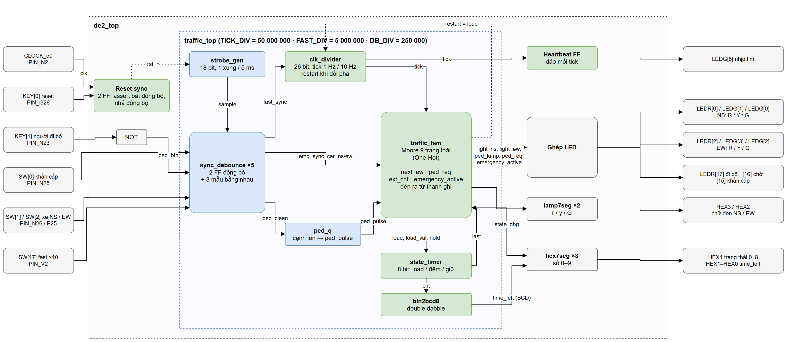

# ICSo – CE2031 Thiết kế vi mạch số

## Project 23: Bộ điều khiển đèn giao thông FSM có chế độ ưu tiên khẩn cấp

Bộ điều khiển đèn giao thông cho ngã tư hai hướng (NS / EW), viết bằng SystemVerilog,
chạy trên FPGA Cyclone II (kit Altera DE2).

- FSM Moore 9 trạng thái: xanh 10 s (kéo dài tới 15 s khi hướng kia không có xe), vàng 3 s,
  đỏ chung 1 s, pha đi bộ 5 s.
- Khẩn cấp: đang xanh thì qua vàng đủ 3 s rồi chuyển toàn đỏ, giữ đến khi hết khẩn cấp,
  sau đó RECOVER 2 s và nhường lượt cho hướng vừa bị cắt.
- Yêu cầu đi bộ được chốt lại và không bị mất khi có khẩn cấp.

Thành viên: Lê Thành Danh (23CE010) · Phan Duy Luân (23CE041)



### Kết quả

| Hạng mục | Kết quả |
|---|---|
| Mô phỏng | 18 test định hướng (305 điểm kiểm tra) + ngẫu nhiên, 3 seed, 102 762 chu kỳ: PASS |
| Coverage | 9/9 trạng thái, 24/24 cung chuyển |
| Golden model Python | 0 sai khác trên cả 3 seed |
| Mutant (lỗi cài giả) | 6/6 bị phát hiện |
| Tổng hợp (Quartus II 13.0sp1, one-hot) | 230 LE, 101 thanh ghi, Fmax 130.98 MHz |

Chi tiết: [báo cáo (PDF)](paper/Nhom5_LETHANHDANH_FINAL.pdf) ·
[slide](slides/Nhom5_LETHANHDANH_FINAL_slides.pptx) ·
[kế hoạch](PLAN.md) · [kịch bản test trên board](board_test_cases.md)

### Mã nguồn

| Thư mục | Nội dung |
|---|---|
| [`rtl/`](rtl) | `traffic_top`, `traffic_fsm`, `state_timer`, `clk_divider`, `sync_debounce`, `strobe_gen`, `bin2bcd8` |
| [`tb/`](tb) | testbench tự kiểm tra, checker 8 thuộc tính, SVA |
| [`model/`](model) | golden model Python |
| [`quartus/`](quartus) | `de2_top`, gán chân, SDC, script biên dịch |
| [`diagrams/`](diagrams) | sơ đồ draw.io và script xuất PDF/PNG |
| [`paper/`](paper) | báo cáo LaTeX, script lấy số liệu và chụp GTKWave |
| [`slides/`](slides) | slide trên template VKU |

### Chạy lại

Trong thư mục gốc của repo (PowerShell):

```powershell
.\run_sim.ps1                     # Icarus Verilog: testbench, golden model, mutant
.\run_modelsim.ps1                # ModelSim-Altera
cd quartus; quartus_sh -t run_quartus.tcl; cd ..
python paper\make_figures.py      # số liệu cho báo cáo
.\paper\capture_gtkwave.ps1       # ảnh chụp GTKWave
python diagrams\export_drawio.py  # xuất lại sơ đồ sau khi sửa .drawio
python slides\build_slides.py     # tạo lại slide
```
